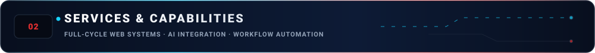
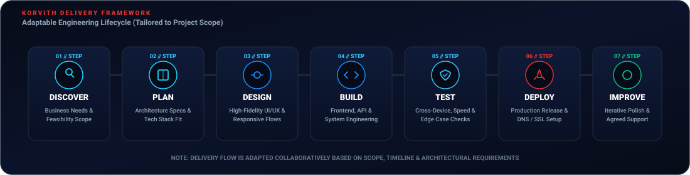
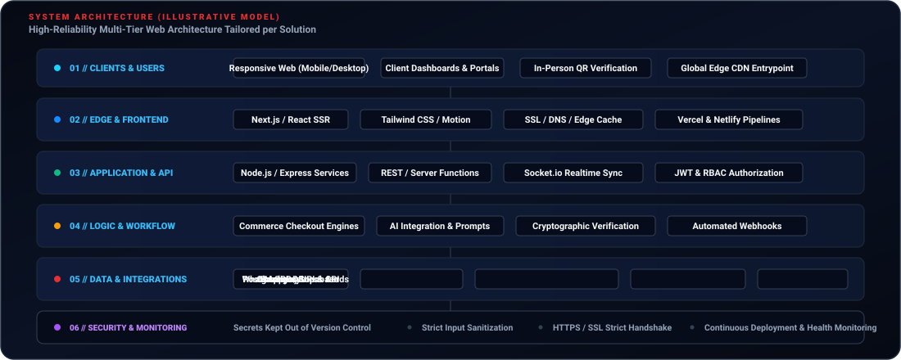
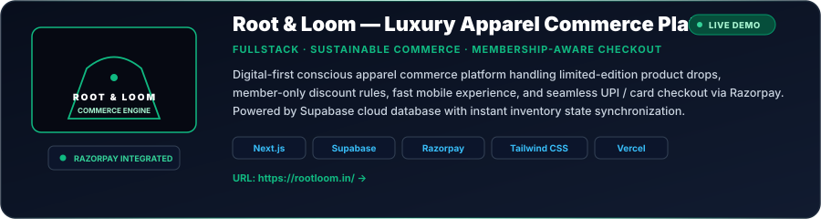
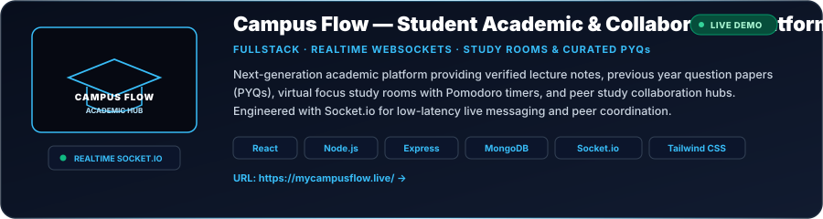
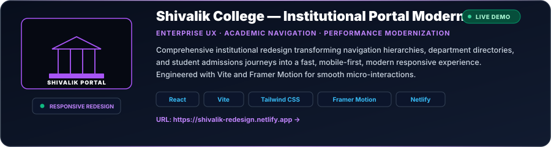
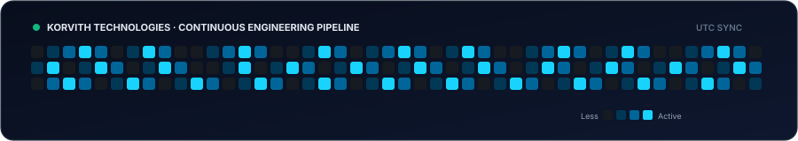

<div align="center">

<!-- ==================== HERO BANNER ==================== -->
<a href="https://korvith.com/" target="_blank" rel="noopener noreferrer">
  
</a>

<br/>

<!-- ==================== ANIMATED BRAND TYPING ==================== -->
<a href="https://korvith.com/" target="_blank" rel="noopener noreferrer">
  
</a>

<noscript>
  <p><strong>Korvith Technologies</strong> — Web Systems, Custom Software, AI Integration, E-Commerce, and Business Automation.</p>
</noscript>

<br/>

<!-- ==================== BRAND BADGES ==================== -->
<p align="center">
  <a href="https://korvith.com/" target="_blank" rel="noopener noreferrer">
    
  </a>
  <a href="https://github.com/korvith-tech" target="_blank" rel="noopener noreferrer">
    
  </a>
  <a href="mailto:hello@korvith.com">
    
  </a>
  <a href="https://wa.me/917500052539" target="_blank" rel="noopener noreferrer">
    
  </a>
  <a href="https://www.linkedin.com/company/korvith/" target="_blank" rel="noopener noreferrer">
    
  </a>
  
</p>

</div>

---

<br/>

<!-- ==================== SECTION 01: ABOUT ==================== -->


<br/>

### Purpose-Built Digital Engineering & Thoughtful Systems

**Korvith Technologies** is a technology services brand operating digitally from **Dehradun, Uttarakhand, India**, delivering remote software engineering, web platforms, and digital solutions to ambitious businesses, educational institutions, healthcare organizations, and startups nationwide.

Our core approach is centered around architectural discipline: we understand real operational requirements before recommending or engineering any technical solution. Rather than applying generic templates, we build purpose-driven software tailored to measurable goals.

```
┌─────────────────────────┐       ┌─────────────────────────┐       ┌─────────────────────────┐
│   BUSINESS PROBLEM      │  ───► │  ENGINEERING & ARCH     │  ───► │   MEASURABLE OUTCOME    │
│  Requirements, Scoping  │       │  React, Next.js, Cloud  │       │  Scalability, Stability │
└─────────────────────────┘       └─────────────────────────┘       └─────────────────────────┘
```

#### Key Operating Tenets:
* 🎯 **Requirement-First Architecture:** Technology stacks are selected to match project requirements, budget, and operational scale — avoiding unneeded architectural complexity.
* 🌐 **Nationwide Remote Delivery:** Headquartered in Dehradun, Uttarakhand, we collaborate seamlessly with clients across India using modern asynchronous tools and milestone-based project planning.
* ⚡ **High-Performance Code:** Focus on fast page load speeds, clean component structures, accessibility (a11y), responsive fluidity across all screen sizes, and enterprise-grade security.

---

<br/>

<!-- ==================== SECTION 02: SERVICES ==================== -->


<br/>

### Core Engineering Capabilities

We offer targeted digital capabilities spanning modern web systems, specialized application portals, e-commerce engines, and workflow automation:

| Capability | Scope & Technical Deliverables | Verified Reference |
| :--- | :--- | :--- |
| **Website Design & Development** | High-performance business websites, marketing landing pages, responsive brand experiences, and website modernizations. | [Explore Service](https://korvith.com/services/web-development/) |
| **Web Applications & Custom Software** | Custom web applications, internal business portals, ERP hubs, resource management tools, and secure role-based dashboards. | [Explore Service](https://korvith.com/services/software-development/) |
| **E-Commerce Development** | Digital storefronts, product catalogues, cart systems, UPI/card payment gateway integrations, and drop-shipping workflows. | [Explore Service](https://korvith.com/services/web-development/) |
| **AI Integration & Automation** | Practical AI features, automated business workflows, customer triage logic, and WhatsApp Business API automations. | [Explore Service](https://korvith.com/services/ai-development/) |
| **Technical SEO & Optimization** | Semantic HTML structure, schema markup, OpenGraph metadata, Core Web Vitals optimization, and search engine readiness. | [Explore Service](https://korvith.com/services/seo-services/) |
| **UI/UX & Interface Design** | User journey mapping, interactive prototypes, design systems, modern typography, and high-contrast digital visual branding. | [Explore Service](https://korvith.com/services/web-development/) |
| **Maintenance & API Support** | Post-launch support, third-party webhook integrations, performance audits, bug resolution, and agreed maintenance cycles. | [Contact Desk](https://korvith.com/contact/) |

---

<br/>

<!-- ==================== SECTION 03: WORKFLOW ==================== -->


<br/>

### Adaptable Delivery Lifecycle

Every project follows a structured yet adaptable workflow designed to maintain transparency, milestone clarity, and rigorous quality verification:

<div align="center">
  
</div>

<br/>

1. **Discover (Scope & Feasibility):** Direct discussion of objectives, operational hurdles, and technical prerequisites.
2. **Plan (Architecture & Milestones):** Formulation of component hierarchy, database schemas, API specs, and delivery schedule.
3. **Design (Interface & UX):** Crafting responsive, intuitive user interfaces with attention to ergonomics and typography.
4. **Build (Implementation):** Clean, modular frontend and backend engineering following modern framework standards.
5. **Test (Quality Assurance):** Cross-browser verification, mobile responsiveness, payment flow checks, and edge-case handling.
6. **Deploy (Production Rollout):** Continuous integration, DNS and SSL configuration, edge caching, and server validation.
7. **Improve (Maintenance):** Agreed technical support, performance checks, and iterative feature enhancements.

---

<br/>

<!-- ==================== SECTION 04: ARCHITECTURE ==================== -->


<br/>

### Typical System Architecture

Our web solutions are designed with clean separation of concerns, ensuring maintainability, observability, and data protection:

<div align="center">
  
</div>

<br/>

#### Verified Technology Stack Matrix

<div align="center">
  <a href="https://skillicons.dev">
    
  </a>
</div>

<br/>

* **Frontend Runtimes & Frameworks:** React 19, Next.js (App Router), TypeScript, JavaScript (ESNext), Vite, Tailwind CSS, Framer Motion.
* **Backend, APIs & Realtime:** Node.js, Express, Socket.io (WebSockets), RESTful Architecture, Serverless Edge Functions, Python.
* **Data Persistence & Cloud Storage:** PostgreSQL, Supabase, MongoDB, Cloudinary Media CDN.
* **Payment & Messaging Integrations:** Razorpay (UPI, Netbanking, Cards), WhatsApp Cloud API, Webhook Event Buses.
* **DevOps, Tooling & Infrastructure:** Git, GitHub Actions, Vercel, Netlify, Postman, Linux environments.

---

<br/>

<!-- ==================== SECTION 05: SELECTED PROJECTS ==================== -->


<br/>

### Case Studies & Verified Production Deployments

Below are select web and software platforms engineered by Korvith. Each card highlights the confirmed technical scope and live destination:

---

#### 1. PennyGrade — Physical Card Discount Membership Network
<div align="center">
  <a href="https://pennygrade.in/" target="_blank" rel="noopener noreferrer">
    
  </a>
</div>

* **Project Overview:** A smart physical discount card membership network delivering guaranteed in-person dining, retail, and wellness privileges across 120+ verified local businesses.
* **Technical Scope:** 100% app-free mobile browser platform. Features a counter QR-code redemption flow that triggers a live 5-minute cryptographic countdown verification screen, allowing cashier verification with zero modifications to existing merchant POS hardware.
* **Core Stack:** React, TanStack Router, TanStack Query, TypeScript, Tailwind CSS, Lucide Icons, Netlify Edge Functions.
* **Live Deployment:** [pennygrade.in](https://pennygrade.in/)

---

#### 2. Root & Loom — Luxury Apparel & Streetwear Commerce Engine
<div align="center">
  <a href="https://rootloom.in/" target="_blank" rel="noopener noreferrer">
    
  </a>
</div>

* **Project Overview:** Direct-to-consumer sustainable streetwear e-commerce platform engineered for limited-edition apparel drops and brand identity storytelling.
* **Technical Scope:** Built on Next.js with server-side rendering, integrated Razorpay payment gateway for instant UPI and card checkouts, dynamic inventory tracking, and membership-aware discount rules powered by Supabase.
* **Core Stack:** Next.js, React, Supabase, Tailwind CSS, Razorpay API, Vercel Edge.
* **Live Deployment:** [rootloom.in](https://rootloom.in/)

---

#### 3. Campus Flow — Student Academic & Realtime Collaboration Hub
<div align="center">
  <a href="https://mycampusflow.live/" target="_blank" rel="noopener noreferrer">
    
  </a>
</div>

* **Project Overview:** A comprehensive academic collaboration and resource platform designed for university students to access verified lecture notes, previous year question papers (PYQs), and study hubs.
* **Technical Scope:** Realtime collaboration study rooms with Pomodoro timers, peer community discussion boards, categorized subject notes search, and low-latency synchronization powered by WebSockets.
* **Core Stack:** React, Node.js, Express, MongoDB, Socket.io, Tailwind CSS, Vite.
* **Live Deployment:** [mycampusflow.live](https://mycampusflow.live/)

---

#### 4. Shivalik College — Institutional Portal Modernization
<div align="center">
  <a href="https://shivalik-redesign.netlify.app" target="_blank" rel="noopener noreferrer">
    
  </a>
</div>

* **Project Overview:** Modernized institutional frontend prototype for an engineering college, restructuring departmental information architectures and campus admissions navigation.
* **Technical Scope:** Mobile-first layout overhaul, optimized loading benchmarks, departmental directory routing, and fluid micro-interactions with Framer Motion.
* **Core Stack:** React, Vite, Tailwind CSS, Framer Motion, Netlify.
* **Live Preview:** [shivalik-redesign.netlify.app](https://shivalik-redesign.netlify.app)

---

<br/>

<!-- ==================== SECTION 06: ENGINEERING PRINCIPLES ==================== -->
### 🛡️ Engineering & Quality Standards

At Korvith, our work adheres to core software craftsmanship practices:

* 🔐 **Strict Secrets Management:** API keys, database credentials, and service tokens are managed exclusively through encrypted environment variables. Zero credentials ever enter version control.
* 🛡️ **Defensive Validation:** All client inputs are sanitized and validated on the server layer before execution to prevent injection and unauthorized access.
* 📱 **Mobile-First & Cross-Browser:** Every interface is tested across multiple viewport dimensions and browser rendering engines to prevent layout degradation.
* 🚀 **Pragmatic Optimization:** Assets, scripts, and fonts are compressed and lazy-loaded to ensure fast First Contentful Paint (FCP) and optimal Lighthouse metrics.
* 📋 **Code Maintainability:** Clean component hierarchy, typed contracts (TypeScript), and modular architecture to facilitate future scaling.

---

<br/>

<!-- ==================== SECTION 07: TELEMETRY & ANALYTICS ==================== -->


<br/>

### GitHub Organization Pulse

<div align="center">

<!-- GitHub Stats & Top Languages -->
<a href="https://github.com/korvith-tech">
  
</a>
&nbsp;
<a href="https://github.com/korvith-tech">
  
</a>

<br/><br/>

<!-- GitHub Streak -->
<a href="https://github.com/korvith-tech">
  
</a>

<br/><br/>

<!-- Contribution Snake Automation -->
<h4>Continuous Contribution Activity</h4>

<picture>
  <source media="(prefers-color-scheme: dark)" srcset="https://raw.githubusercontent.com/korvith-tech/korvith-tech/output/github-contribution-grid-snake-dark.svg">
  <source media="(prefers-color-scheme: light)" srcset="https://raw.githubusercontent.com/korvith-tech/korvith-tech/output/github-contribution-grid-snake.svg">
  
</picture>

<p><sub><em>Note: GitHub statistics reflect public repository contributions on this organization account. Activity will continue to expand as additional open-source modules and public templates are released.</em></sub></p>

</div>

---

<br/>

<!-- ==================== SECTION 08: CONNECT & DIRECT CHANNELS ==================== -->


<br/>

<div align="center">

### Let's discuss what you are building.

Have an upcoming web project, business portal requirement, e-commerce drop, or workflow automation inquiry? Reach out directly:

<br/>

| Channel | Contact Point | Expected Response |
| :--- | :--- | :--- |
| 🌐 **Official Website** | [korvith.com](https://korvith.com/) | Project briefs & full agency portfolio |
| ✉️ **Direct Email** | [hello@korvith.com](mailto:hello@korvith.com) | Scope documents & technical inquiries |
| 💬 **WhatsApp Desk** | [+91 75000 52539](https://wa.me/917500052539) | Instant project chat & consultation |
| 📞 **Direct Phone** | [+91 75000 52539](tel:+917500052539) | Direct helpline for project consultation |
| 💼 **LinkedIn Profile** | [linkedin.com/company/korvith](https://www.linkedin.com/company/korvith/) | Corporate network & engineering updates |
| 📸 **Instagram Channel** | [@korvith.in](https://www.instagram.com/korvith.in/) | Company showcases & design stories |
| 📍 **Base Location** | Dehradun, Uttarakhand, India | Remote delivery for businesses across India |

<br/>

<p align="center">
  <a href="https://korvith.com/contact/">
    
  </a>
  &nbsp;
  <a href="https://wa.me/917500052539">
    
  </a>
</p>

<br/>

<!-- ==================== FOOTER ==================== -->
<a href="https://korvith.com/">
  
</a>

</div>
